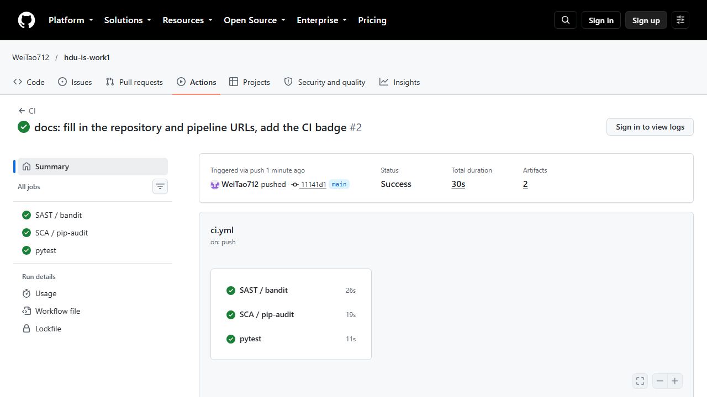

# HDU IS — Work 1: Secure REST API with CI/CD and Real-CVE Remediation

[](https://github.com/WeiTao712/hdu-is-work1/actions/workflows/ci.yml)

A small but complete REST API (Flask + SQLite) built with the OWASP Top 10 in
mind, wired to a GitHub Actions pipeline with SAST and SCA, plus a full
reproduction → root-cause → fix → verification cycle for a real vulnerability
(**CVE-2024-1561**, gradio) in a Vulhub environment.

| | |
|---|---|
| Language / stack | Python 3.11, Flask 3.1.3, SQLite |
| Auth | JWT (HS256, 15 min) + bcrypt password hashing |
| CI | GitHub Actions: bandit (SAST), pip-audit (SCA), pytest |
| CVE | CVE-2024-1561 — gradio arbitrary file read (CVSS 7.5) |

---

## 1. Repository layout

```
.
├─ app/
│  ├─ __init__.py        application factory, security headers, DB bootstrap
│  ├─ config.py          environment-driven configuration, production guards
│  ├─ db.py              SQLite layer — every query is parameterised
│  ├─ security.py        bcrypt, JWT issue/verify, token middleware, rate limit
│  ├─ validation.py      input validation helpers
│  ├─ errors.py          JSON error handlers (no stack traces leak)
│  └─ routes/
│     ├─ auth.py         /auth/register, /auth/login, /auth/logout
│     └─ posts.py        /api/data, /api/posts, /api/posts/<id>, .../preview
├─ tests/                28 functional + security tests
├─ .github/workflows/ci.yml   SAST (bandit) + SCA (pip-audit) + pytest on every push/PR
├─ cve-fixes/            CVE-2024-1561: vulnerable env, exploit, fixed image, verification
├─ evidence/             raw transcripts of every check quoted in this README
├─ report/               the lab report (PDF/DOCX) and the script that builds it
├─ Dockerfile            production image (waitress, non-root user)
├─ requirements.txt      pinned runtime dependencies
└─ run.py                development entry point
```

## 2. API

Base URL: `http://127.0.0.1:5000`

| Method | Path | Auth | Purpose |
|---|---|---|---|
| `GET` | `/health` | – | liveness probe |
| `POST` | `/auth/register` | – | create a user (password policy enforced) |
| `POST` | `/auth/login` | – | exchange username + password for a JWT |
| `POST` | `/auth/logout` | Bearer | revoke the presented token |
| `GET` | `/api/data` | Bearer | list posts, optional `?q=` search |
| `POST` | `/api/posts` | Bearer | create a post |
| `GET` | `/api/posts/<id>` | Bearer | read one post (JSON) |
| `GET` | `/api/posts/<id>/preview` | Bearer | read one post (escaped HTML) |

### Running locally

```bash
python -m venv .venv && . .venv/bin/activate      # Windows: .venv\Scripts\activate
pip install -r requirements-dev.txt
export JWT_SECRET="$(python -c 'import secrets;print(secrets.token_urlsafe(48))')"
python run.py                                     # http://127.0.0.1:5000
```

The database is created and seeded on first start with a demo account
(`demo` / `DemoPassw0rd!2024`).

### Calling the API

```bash
# 1. log in and keep the token
TOKEN=$(curl -s -X POST http://127.0.0.1:5000/auth/login \
        -H 'Content-Type: application/json' \
        -d '{"username":"demo","password":"DemoPassw0rd!2024"}' | python -c 'import json,sys;print(json.load(sys.stdin)["access_token"])')

# 2. protected read
curl -s -H "Authorization: Bearer $TOKEN" http://127.0.0.1:5000/api/data

# 3. protected write
curl -s -X POST http://127.0.0.1:5000/api/posts \
     -H "Authorization: Bearer $TOKEN" -H 'Content-Type: application/json' \
     -d '{"title":"Hello","body":"first post"}'

# 4. search
curl -s -G -H "Authorization: Bearer $TOKEN" \
     --data-urlencode "q=queries" http://127.0.0.1:5000/api/data
```

---

## 3. Security measures

### 3.1 SQL injection — parameterised statements only

Every statement lives in `app/db.py` and passes its data as *bound parameters*;
no user value is ever interpolated into SQL text.

```python
cur = conn.execute(
    "SELECT id, username, password_hash, display_name FROM users WHERE username = ?",
    (username,),
)
```

Free-text search is the only place where user input influences the *shape* of a
value, and there it is still a bound parameter — only the LIKE metacharacters
are escaped:

```python
def like_pattern(term: str) -> str:
    escaped = term.replace("\\", "\\\\").replace("%", "\\%").replace("_", "\\_")
    return f"%{escaped}%"
```

Proof (real transcript, `evidence/api_demo.txt`):

```
$ curl -s -G -H "Authorization: Bearer $TOKEN" --data-urlencode "q=' OR 1=1 --" \
       http://127.0.0.1:5000/api/data
{"count":1,"items":[{"author":"demo","body":"Every SQL statement in this project binds its
 arguments, so ' OR 1=1 -- stays a literal string.","id":2,"title":"Parameterised queries"}]}

< HTTP 200
```

The payload returned **one** row — the seeded post that literally contains that
text. An injection would have returned all three rows.

### 3.2 XSS — output encoding, never input "sanitising"

User data is stored as-is and escaped **at the moment it enters an HTML
document**. The `/api/posts/<id>/preview` endpoint is the only HTML-producing
route, and it escapes every value with `markupsafe.escape`:

```python
f"<h1>{escape(row['title'])}</h1><article>{escape(row['body'])}</article>"
```

plus a restrictive `Content-Security-Policy` on that response and
`X-Content-Type-Options: nosniff` on every response, so JSON is never sniffed as
HTML.

Proof (real transcript):

```
$ curl -s -X POST .../api/posts -d '{"title":"<script>alert(1)</script>",
                                     "body":""}'
{"author":"demo","body":"","id":4,
 "title":"<script>alert(1)</script>"}

$ curl -s -i -H "Authorization: Bearer $TOKEN" .../api/posts/4/preview
HTTP/1.1 200 OK
Content-Type: text/html; charset=utf-8
Content-Security-Policy: default-src 'none'; style-src 'self'; img-src 'self'; base-uri 'none'; form-action 'none'
...
<h1>&lt;script&gt;alert(1)&lt;/script&gt;</h1>
<article>&lt;img src=x onerror=alert(document.cookie)&gt;</article>
```

The payload round-trips as data and is inert in the browser.

### 3.3 Authentication — JWT + bcrypt

* **Hashing**: bcrypt with cost 12 (`bcrypt.hashpw`), never plaintext, never
  SHA-256. Passwords are compared with `bcrypt.checkpw`; a malformed hash in the
  database yields "no match" instead of a crash. Passwords > 72 bytes are
  rejected (bcrypt truncation).
* **Policy**: ≥ 12 characters, letters + digits, common passwords rejected.
* **Token**: HS256, `sub`/`username`/`iat`/`nbf`/`exp`/`jti`/`iss`/`aud`,
  15-minute lifetime. Decoding pins the algorithm allow-list (`algorithms=["HS256"]`)
  and requires `exp`, `iat`, `sub`, `jti`, which defeats `alg: none` and
  RS256→HS256 key confusion.
* **Middleware**: `@token_required` guards every non-public endpoint and returns
  a uniform JSON 401; `Authorization` parsing is strict (`Bearer <token>`).
* **Revocation**: `/auth/logout` adds the `jti` to a revocation list checked on
  every request.
* **Brute force**: 5 failed attempts per username *and* per source address
  inside a 5-minute window → `429` + `Retry-After`; a successful login resets
  the counters.
* **No user enumeration**: unknown user and wrong password return the same
  message, and a dummy bcrypt comparison keeps the timing similar.

Proof:

```
$ curl -s -X POST .../auth/login -d @login_bad.json
{"error":"invalid_credentials","message":"Invalid username or password","status":401}

$ curl -s http://127.0.0.1:5000/api/data
{"error":"authentication_required","message":"A Bearer token is required for this endpoint","status":401}

$ curl -s -H "Authorization: Bearer <tampered>" http://127.0.0.1:5000/api/data
{"error":"invalid_token","message":"Invalid token","status":401}

$ curl -s -X POST -H "Authorization: Bearer $TOKEN" http://127.0.0.1:5000/auth/logout
{"message":"Token revoked"}
$ curl -s -H "Authorization: Bearer $TOKEN" http://127.0.0.1:5000/api/data
{"error":"invalid_token","message":"Token has been revoked","status":401}
```

### 3.4 Other hardening

* security headers on every response (`nosniff`, `X-Frame-Options: DENY`,
  `Referrer-Policy: no-referrer`, `Cache-Control: no-store`, CSP);
* `MAX_CONTENT_LENGTH = 64 KiB` (request-body flooding);
* strict input validation (username regex, length caps, control-character
  rejection) *before* any database access;
* JSON error handlers only — no traceback ever reaches the client;
* secrets from the environment, `.env` git-ignored, config refuses to start in
  production without `JWT_SECRET` and with `DEBUG` enabled;
* container runs as UID 10001 under `waitress`, not the Flask dev server.

### 3.5 Test suite

```
$ pytest -v
...
28 passed in 1.39s
```

The tests double as security regression tests: SQLi payloads in `q` and in the
login body, `UNION SELECT` attempts, stored-XSS round-trip, tampered signature,
`alg: none`, expired token, revocation, weak-password rejection, rate limiting,
security headers, oversized body.

---

## 4. CI/CD pipeline

`.github/workflows/ci.yml` runs on **every push and every pull request**:

| Job | Tool | Failure condition | Output |
|---|---|---|---|
| `sast-bandit` | bandit 1.7.10 | any finding of severity ≥ MEDIUM | `bandit.sarif` artifact + Security tab |
| `sca-pip-audit` | pip-audit 2.7.3 | any known-vulnerable dependency (`--strict`) | `pip-audit.txt` artifact |
| `tests` | pytest | any failing test | job log |

Local reproduction of the same two scanners:

```
$ bandit -r app run.py -ll -f screen
Run started:2026-10-22 ...
Test results:
	No issues identified.

Code scanned:
	Total lines of code: 638
	Total issues (by severity):
		High: 0
		Medium: 0
		Low: 2
```

<!-- SCA-OUTPUT -->

### 4.1 The SCA stage found real problems — and they were fixed

The first pipeline run was **red on purpose-built ground**: pip-audit reported
advisories against my own pinned versions (Flask 3.0.3, PyJWT 2.9.0). The pins
were upgraded and the scan now passes:

```
$ pip-audit --path .runtime          # BEFORE the upgrade
Found 17 known vulnerabilities in 2 packages
Name  Version ID              Fix Versions
flask 3.0.3   PYSEC-2026-2151 3.1.3
pyjwt 2.9.0   PYSEC-2026-120  2.12.0
pyjwt 2.9.0   PYSEC-2025-183
... (15 more on pyjwt)

$ pip-audit --path .runtime          # AFTER the upgrade
No known vulnerabilities found
```

This is the SCA stage doing exactly what it is for, and it is the same
mechanism that flags `gradio==4.12.0` in section 5. The upgrade was applied as a
normal commit (`requirements.txt`), all 28 tests were re-run against the new
versions, and only then was the pipeline green.

### 4.2 The pipeline in GitHub Actions



The run above is the real one: [run #2](https://github.com/WeiTao712/hdu-is-work1/actions/runs/40438088859)
— SAST 26 s, SCA 19 s, tests 11 s, status **Success**, with the `bandit-report` and
`pip-audit-report` artifacts attached to the run. The console output quoted in §4.1
and §6.2 comes from the same scanners run locally with the same versions and flags.

---

## 5. CVE analysis — CVE-2024-1561

| Field | Value |
|---|---|
| CVE | **CVE-2024-1561** |
| Product | gradio (Python web UI framework) |
| Affected | `>= 4.12.0, < 4.13.0` |
| Fixed | **4.13.0** (gradio-app/gradio commit `24a5836`) |
| CVSS v3.0 | 7.5 HIGH — `AV:N/AC:L/PR:N/UI:N/S:U/C:H/I:N/A:N` |
| CWE | CWE-29 Path Traversal |
| Class | Broken access control / unsafe exposure of an internal API |

The `component_server` endpoint, which is reachable **without authentication**,
lets a caller invoke any method of a `Component`/`Block` object. By naming
`move_resource_to_block_cache` the attacker copies an arbitrary file into
gradio's temporary directory and then downloads it through `/file=`.

Reproduction, root cause, fix and verification are fully documented in
[`cve-fixes/README.md`](cve-fixes/README.md) and implemented in
[`cve-fixes/exploit/gradio_exploit.py`](cve-fixes/exploit/gradio_exploit.py).

## 6. Deliverables map

| Assignment requirement | Where |
|---|---|
| Public git repository | <https://github.com/WeiTao712/hdu-is-work1> |
| README with API + security description | this file |
| SAST/SCA screenshots | §4 and `evidence/` |
| CVE id + description | §5 |
| Reproduction sequence | `cve-fixes/README.md` §2 |
| Root-cause analysis | `cve-fixes/README.md` §3 |
| Fix description | `cve-fixes/README.md` §4 |
| Proof the attack no longer works | `cve-fixes/README.md` §5, `evidence/` |
| Link to the last successful pipeline | see the Actions tab: <https://github.com/WeiTao712/hdu-is-work1/actions> |
| Folder with the fixes | `cve-fixes/` (`Dockerfile.fixed`, `docker-compose.fixed.yml`) |

## 7. Licence / academic note

Coursework for HDU IS. The vulnerable environment is used only inside the
provided Vulhub containers; no live system is attacked.
